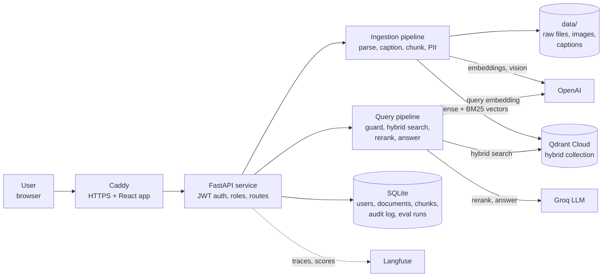
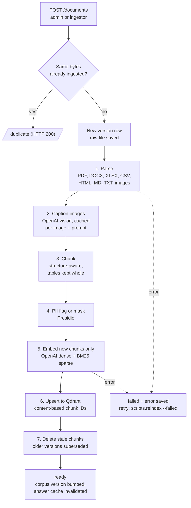
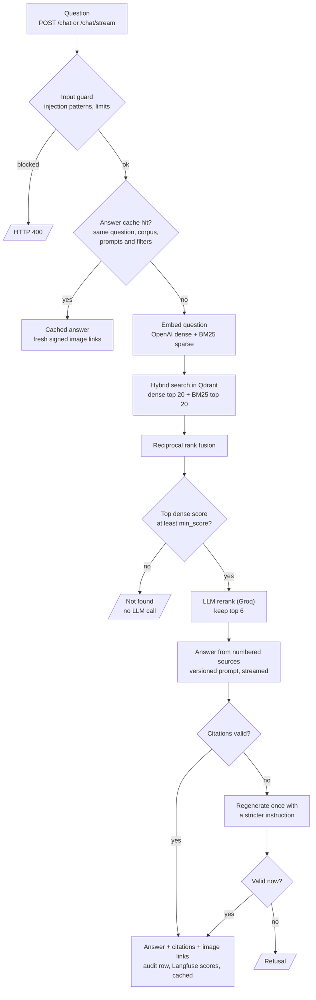
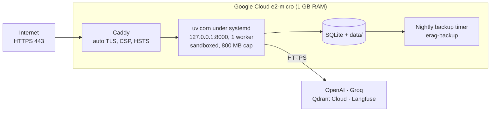

# Multimodal Hybrid RAG

Question answering over your own documents (PDF, Office, HTML, text and images) with **hybrid retrieval**:
dense vector search and BM25 keyword search in Qdrant, fused with reciprocal rank fusion, then LLM reranking.
Every answer cites its sources, and guardrails, PII masking, versioned prompts, Langfuse tracing and an evaluation
gate are built in. Runs on a free-tier stack. Design: [docs/tech-stack.pdf](docs/tech-stack.pdf).

| Job | Provider |
|---|---|
| Embeddings, vision/OCR | OpenAI |
| Answers, rerank, judge | Groq |
| Vector DB | Qdrant Cloud |
| Tracing | Langfuse |
| Metadata / files | SQLite / local `data/` |

Providers are chosen in `config/config.yaml`; secrets go in `.env`.

## Contents

[Architecture](#architecture) · [Ingestion flow](#ingestion-flow) · [Query flow](#query-flow-hybrid-retrieval) ·
[Deployment](#deployment) · [Source structure](#source-code-structure) · [Tech stack](#tech-stack) ·
[Status](#status) · [Tracing](#tracing-langfuse) · [Postman](#postman) · [UI](#ui) · [Evaluation](#evaluation) ·
[Chat](#chat) · [Ingestion](#ingestion) · [Run](#run)

## Architecture



Uploads and questions go through one FastAPI service. Ingestion writes vectors to Qdrant and metadata to SQLite;
the query pipeline reads both. Langfuse receives IDs, scores and timings, not document text (by default).

## Ingestion flow



Chunk IDs are a hash of the content, so a new version of a file only embeds the chunks that changed.
A restart mid-ingestion marks the document `failed` on the next start, so it can be retried.

## Query flow (hybrid retrieval)



Weak evidence never reaches the LLM, and an answer whose citations cannot be checked is refused rather than shown.

## Deployment



Scripts are in `deploy/` (see `deploy/README.md`); they have not been run on a real VM yet.
Qdrant vectors are not in the backup: `scripts.reindex --all` rebuilds them from the raw files.

## Source code structure

```
app/
  main.py           FastAPI app, startup sweep, static UI
  routers/          auth, documents, chat (JSON + SSE streaming, feedback, signed assets)
  ingestion/        parsers, chunking, BM25 sparse vectors, pipeline, reindex
  retrieval/        query pipeline, LLM rerank, answer cache
  providers/        OpenAI (embeddings, vision) and Groq (LLM) adapters
  vectorstore.py    Qdrant hybrid collection (dense + BM25, RRF)
  guardrails.py     input and output checks          pii.py      Presidio flag / mask
  prompts.py        versioned prompt registry        tracing.py  Langfuse spans and scores
  auth.py, db.py, settings.py, signing.py, deps.py
prompts/            prompt files, one per version (answer, rerank, caption, citation_retry)
config/             config.yaml (providers, retrieval, cache, prompt versions), guardrails.yaml
evaluation/         golden and red-team runner, metrics, thresholds gate, RAGAS export
frontend/           React + TypeScript + Vite UI
scripts/            create_admin, reindex
deploy/             install script, systemd units, Caddyfile, backup and restore
postman/            API collection and environment
tests/              117 backend tests (fakes only, no network)
docs/               design document (tech-stack.pdf)
```

## Tech stack

| Layer | Implementation |
| --- | --- |
| API | FastAPI, Pydantic v2, aiosqlite over SQLite, JWT (HS256) with roles, Argon2 passwords |
| Retrieval | Qdrant Cloud: dense (OpenAI `text-embedding-3-small`, 768 dims) + BM25 (fastembed), RRF fusion |
| LLMs | Groq for answers and reranking; OpenAI vision for image captions and OCR |
| Safety | Input and output guardrails, Presidio PII, citation checks, relevance gate, red-team set |
| Quality | Evaluation harness with a thresholds gate, versioned prompts with content hashes |
| Observability | Langfuse traces, spans and scores; audit log in SQLite |
| Front end | React 18, TypeScript, Vite |
| Delivery | systemd, Caddy, nightly backups on a Google Cloud VM |

## Status

Built: config, SQLite schema, JWT auth with roles (admin / ingestor / user), provider interfaces and adapters, health endpoint, ingestion, retrieval and chat with guardrails.
Built since: evaluation harness (`evaluation/`); versioned prompts (`prompts/`); exact-match answer cache invalidated
on every ingestion or delete; startup sweep for interrupted ingestions; `scripts.reindex` to retry failures or rebuild Qdrant.
Deploy scripts written (`deploy/`, see `deploy/README.md`): not yet run on a real VM.
Langfuse tracing built (below), tested against the real SDK with a mock server, not against Langfuse Cloud.

## Tracing (Langfuse)

Set `LANGFUSE_PUBLIC_KEY` and `LANGFUSE_SECRET_KEY` (and `LANGFUSE_HOST` for a non-default region) in `.env`; without
both keys tracing is a no-op. Each question is one trace `query` with spans `guard`, `embed_query`, `retrieve`,
`rerank`, `generate` (with time to first token), `output_check`; each upload is a trace `ingest` with `parse`, `caption`,
`chunk`, `pii`, `embed_and_upsert`. Scores on every answer: `found`, `top_dense`, `citation_valid`, `regenerated`,
`gated`, `blocked`; thumbs up/down in the UI becomes `user_feedback` (`POST /chat/feedback`).

Privacy: user IDs are hashed; by default (`tracing.log_content: false`) no question, answer, document text or file name is
sent, only chunk IDs, scores, counts and timings; with it on, text is masked with Presidio first. The SDK sends in a
background thread, so a Langfuse outage costs only the traces, never an answer.
Not done: Langfuse prompt management, nightly eval runs as Langfuse experiments, LLM-judged online scoring of a sample.

## Postman

Import `postman/enterprise-rag.postman_collection.json` and `postman/local.postman_environment.json`, set the
environment's `username` and `password` (an admin account for the full run), then run the collection in order.
It saves the token and document ID itself, uploads `postman/sample/refunds.md`, waits for ingestion, and checks chat,
streaming, guardrail blocks, 401/415/422 cases and cleanup. Command line:

```bash
cd postman && npx newman run enterprise-rag.postman_collection.json -e local.postman_environment.json \
  --env-var "password=<admin password>" --working-dir .
```

## UI

React + TypeScript + Vite in `frontend/`: sign-in, streaming chat (citations, source images, document/type filters),
document upload and status, admin user creation. Build once; FastAPI then serves it from the same origin.

```bash
cd frontend && npm install && npm run build     # needs Node 18+; output in frontend/dist (not needed on the VM)
```

Dev with hot reload: run the API on :8000, then `npm run dev` (port 5173, proxies API calls).
The UI uses hash routes (`#/documents`) so they never clash with API paths. The JWT is kept in `sessionStorage`.

## Evaluation

```bash
cp evaluation/golden.example.yaml evaluation/golden.yaml    # then write your own questions
.venv/Scripts/python -m evaluation.run                      # golden set + red-team, gate, exit 1 on failure
.venv/Scripts/python -m evaluation.run --limit 15           # fast CI gate
.venv/Scripts/python -m evaluation.run --no-rerank          # compare retrieval without rerank
.venv/Scripts/python -m evaluation.export_ragas data/eval/eval-<stamp>.json ragas_input.jsonl
```

Metrics: recall@k, hit rate, MRR, citation hit/precision, answer correctness (`answer_contains`), false-refusal
and refusal-correct rates, latency p50/p95, red-team attack success and false-block rates. Reports go to
`data/eval/` and a row in `eval_runs`. Thresholds live in `evaluation/thresholds.yaml` (starting values only).
Faithfulness and answer relevancy come from RAGAS on a dev PC or CI using the JSONL export (not run here).

## Chat

`POST /chat` (JSON) and `POST /chat/stream` (SSE: `token`, `replace`, `final` events), any logged-in role.
Flow: input guard (policy in `config/guardrails.yaml`) -> embed question (OpenAI) + BM25 -> Qdrant hybrid search (RRF) ->
relevance gate (top dense score below `retrieval.min_score` = "not found", no LLM call) -> Groq rerank -> prompt with
`[S#]` sources (instruction-like lines removed) -> Groq answer -> citation check (regenerate once, then refuse) ->
answer + citations + signed image links (`/assets/...`, expire after 5 min) -> audit row.
Per-user daily limit comes from the audit log.

## Ingestion

`POST /documents` (admin or ingestor) -> SHA-256 check -> versioning -> background pipeline:
parse (PDF, DOCX, XLSX, CSV, HTML, MD, TXT, images) -> caption images (OpenAI vision, cached) ->
chunk -> PII flag/mask (Presidio) -> OpenAI embeddings + BM25 sparse -> Qdrant.
Chunk IDs come from content, so an edited file only re-embeds the changed chunks and stale chunks are removed.
Also: `GET /documents`, `GET /documents/{id}`, `DELETE /documents/{id}` (admin).

## Run

```bash
python -m venv .venv
.venv/Scripts/python -m pip install -r requirements.txt   # Windows; use .venv/bin on Linux
cp .env.example .env                                       # then fill in keys, set JWT_SECRET
.venv/Scripts/python -m scripts.create_admin --username admin --role admin
.venv/Scripts/python -m uvicorn app.main:app --reload      # Swagger at /docs
.venv/Scripts/python -m pytest
.venv/Scripts/python -m scripts.reindex --failed           # retry failed/interrupted ingestions (--all rebuilds Qdrant)
```
